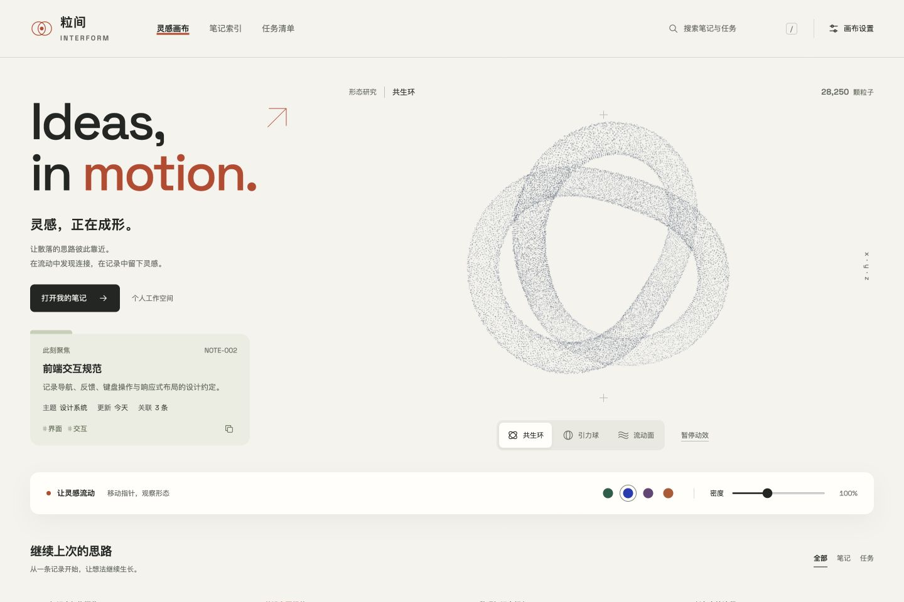

# 粒间 INTERFORM · 灵感创作台

暖白纸面、开放式粒子雕塑与横向导航组成的原创本地前端。页面使用示例笔记与任务，没有连接真实 Obsidian Vault。

[在线体验](https://aroa15792-web.github.io/interform-particle-studio/) · [GitHub 源码](https://github.com/aroa15792-web/interform-particle-studio)



## 本地启动

在本目录运行：

```bash
python3 -m http.server 8876 --bind 127.0.0.1
```

浏览器打开 http://127.0.0.1:8876/ 。保持终端运行；再次使用时按同样方式启动。所有脚本、样式与字体均在包内，无需安装前端依赖。

## 功能

- 三种可平滑切换的粒子形态：共生环、引力球、流动面。
- 桌面默认 28,250 颗粒子，160% 密度时 45,138 颗；手机默认 18,650 颗，实际数量随视口变化。
- 密度范围 65%–160%，四种配色，动效暂停；支持系统减少动态效果偏好。
- 12 篇示例笔记：搜索、主题筛选、选择详情与复制标题。
- 8 项示例任务：勾选状态和粒子偏好保存在当前浏览器。
- 桌面、手机响应式布局；WebGL 不可用时降级到 Canvas 或静态呈现。

## 文件

| 文件 | 用途 |
| --- | --- |
| index.html | 页面结构 |
| styles.css | 视觉与响应式布局 |
| app.js | 示例数据和交互 |
| particles.js | 原创粒子引擎 |
| assets/SpaceGrotesk.ttf | 本地字体 |
| assets/OFL.txt | 字体许可 |

## 验证范围

已检查 JavaScript 语法，并在浏览器验证形态、密度、暂停、配色、笔记搜索与详情、任务勾选；1440px 与 390px 布局无横向溢出。页面使用演示数据。真实笔记接入需要另外实现数据桥及读写验证。


## GitHub Pages 自动部署

项目已包含 `.github/workflows/pages.yml`。在仓库 Settings → Pages 中将 Source 设为 **GitHub Actions** 后，每次推送到 `main` 自动进行脚本语法检查并部署静态页面；也可在 Actions 中手动运行工作流。

所有页面资源使用相对路径，支持 GitHub Pages 的仓库子路径。部署仅上传页面、字体及许可文件。任务和配色保存在各访问者自己的浏览器，不会上传到仓库。

## 开源许可

原创代码与文档使用 [MIT License](LICENSE)。Space Grotesk 字体使用 [SIL OFL 1.1](assets/OFL.txt)，详见 [第三方许可说明](THIRD_PARTY_NOTICES.md)。
